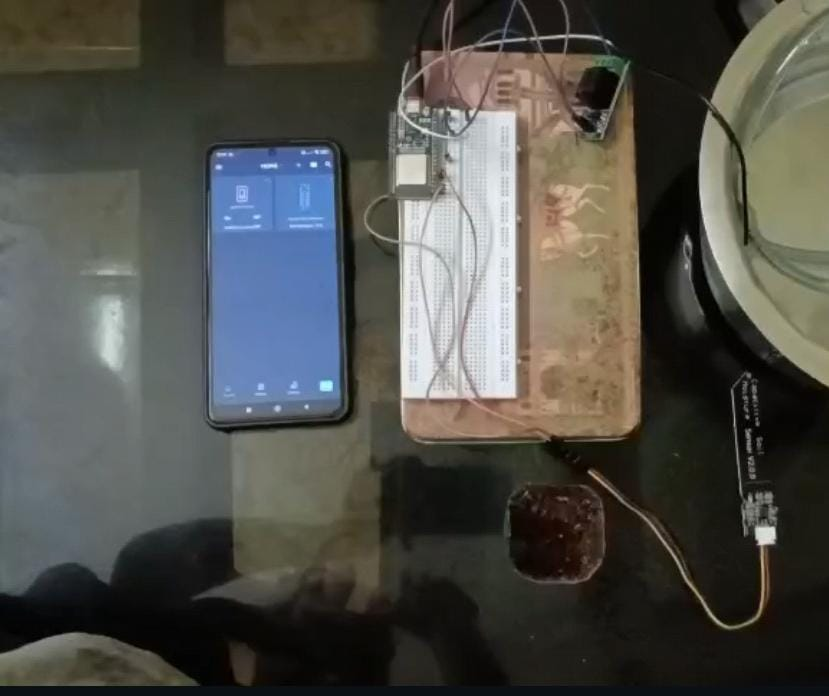

# IoT-Based Plant Monitoring System Using ESP32

An IoT-based plant monitoring and automatic irrigation system using ESP32, a capacitive soil moisture sensor, a relay module, and a mini water pump. The system continuously monitors soil moisture, automatically waters the plant when the soil becomes dry, and allows users to remotely monitor and control the irrigation process through the Sinric Pro mobile application.

## Project Overview

Traditional plant watering depends on manual observation and can lead to overwatering or underwatering. This project provides an automated solution by integrating soil moisture sensing, wireless communication, and cloud-based monitoring.

The ESP32 reads the analogue output of the capacitive soil moisture sensor and converts it into a moisture percentage (0–100%). When the moisture level falls below a predefined threshold, the ESP32 activates a relay, switching ON the water pump. Once the required moisture level is reached, the pump is automatically switched OFF.

The system is also integrated with Sinric Pro, enabling real-time moisture monitoring, remote pump control, and mobile push notifications.

## Features

- Real-time soil moisture monitoring.
- Automatic plant watering based on soil moisture levels.
- Remote monitoring through the Sinric Pro mobile application.
- Manual ON/OFF control of the water pump.
- Push notifications when the soil becomes too dry.
- Wi-Fi connectivity using ESP32.
- Low-cost and efficient irrigation system.

## Hardware Components

| Component | Purpose |
|---|---|
| ESP32 Development Board | Main microcontroller |
| Capacitive Soil Moisture Sensor V2.0 | Measures soil moisture |
| 5V Relay Module | Controls the water pump |
| Mini Water Pump | Supplies water to the plant |
| Water Reservoir | Stores water |
| Tubing | Transfers water to the plant |
| Breadboard and Jumper Wires | Circuit connections |
| Power Supply | Powers the system |

## Software and Platforms

- Arduino IDE
- Sinric Pro IoT Platform
- ESP32 Arduino Core
- SinricPro Library
- WebSockets Library
- ArduinoJson Library

## Working Principle

1. The capacitive soil moisture sensor continuously measures the moisture level of the soil.
2. The ESP32 reads the analogue output from the sensor.
3. The raw sensor readings are calibrated and converted into a moisture percentage (0–100%).
4. The moisture percentage is sent to Sinric Pro and displayed on the mobile application.
5. When the moisture level falls below the predefined threshold, the ESP32 activates the relay.
6. The relay switches ON the water pump, supplying water to the plant.
7. When the required moisture level is reached, the ESP32 deactivates the relay and switches OFF the pump.
8. Users can also manually control the pump through the Sinric Pro application.
9. Push notifications alert users when the soil becomes too dry.

## Sinric Pro Integration

Sinric Pro is used as the cloud-based IoT platform for remote monitoring, device control, and notifications.

### 1. Creating a Sinric Pro Account

1. Visit [Sinric Pro](https://sinric.pro/).
2. Create an account and log in to the dashboard.
3. Open the Device Templates section.

### 2. Creating a Custom Moisture Sensor Template

Since the capacitive soil moisture sensor is not available as a built-in device type, a custom device template is created.

1. Select **Add Device Template**.
2. Enter the template name as `Moisture Sensor`.
3. Add a description: `Moisture Sensor`.
4. Select the appropriate device type.
5. Navigate to the Capabilities section.
6. Add the following capabilities:

**Range Capability**
- Instance: `rangeInstance1`
- Range Name: `Soil Moisture`
- Minimum Value: `0`
- Maximum Value: `100`
- Precision: `1`

**Mode Capability**
- Instance: `modeInstance1`
- Mode Name: `Soil Type`
- Mode Values: `Wet`, `Dry`

**Push Notification Capability**
- Enable Push Notification to receive alerts when the soil becomes too dry.

7. Save the device template.

### 3. Creating the Soil Moisture Device

1. Open the **Devices** section.
2. Select **Add Device**.
3. Enter the device name as `Garden Soil Moisture`.
4. Add the description: `Garden Soil Moisture`.
5. Select the previously created `Moisture Sensor` template.
6. Open the Others tab and save the device.

### 4. Creating the Water Pump Device

1. Open the **Devices** section.
2. Select **Add Device**.
3. Enter the device name as `Garden Pump`.
4. Add the description: `Garden Pump`.
5. Select **Switch** as the device type.
6. Open the Others tab and save the device.

### 5. Obtaining Credentials and Device IDs

1. Open the **Credentials** section in the Sinric Pro dashboard.
2. Copy the APP KEY and APP SECRET.
3. Navigate to the Devices section.
4. Copy the Device IDs of:
   - Garden Soil Moisture
   - Garden Pump
5. Add these credentials and device IDs to the ESP32 program along with the Wi-Fi SSID and password.

**Note:** Never upload your actual Wi-Fi password, APP KEY, or APP SECRET to a public GitHub repository. Store them in a separate configuration file excluded through `.gitignore`.

### 6. Installing Required Libraries

Install the following libraries through the Arduino IDE Library Manager:

- SinricPro
- ArduinoJson
- WebSockets

Reference library repositories:

- [SinricPro Library](https://github.com/sinricpro/esp8266-esp32-sdk)
- [ArduinoJson](https://arduinojson.org/)
- [WebSockets](https://github.com/Links2004/arduinoWebSockets)

The reference tutorial specifies SinricPro 3.5.2, ArduinoJson 7.0.3 or later, and WebSockets 2.4.0 or later.

### 7. Sensor Calibration

1. Connect the analogue output of the soil moisture sensor to the configured ESP32 ADC pin.
2. Read the raw sensor values using the Arduino IDE Serial Monitor.
3. Record readings under dry and wet soil conditions.
4. Use these readings to determine the calibration values.
5. Configure the moisture threshold for automatic irrigation.

Calibration values may vary depending on the sensor and soil conditions.

### 8. Uploading the Program to ESP32

1. Install ESP32 board support in Arduino IDE.
2. Select the appropriate ESP32 board and COM port.
3. Enter the Wi-Fi credentials, Sinric Pro APP KEY, APP SECRET, and Device IDs.
4. Verify the sensor and relay pin configurations.
5. Upload the program to the ESP32.
6. Open the Serial Monitor to verify Wi-Fi and Sinric Pro connectivity.

### 9. Configuring the Sinric Pro Mobile Application

1. Install the Sinric Pro mobile application.
2. Log in using the same account used to create the devices.
3. Open the device dashboard.
4. Select `Garden Soil Moisture` to monitor the live moisture percentage.
5. Use the `Garden Pump` switch to manually control the water pump.
6. Enable mobile notifications to receive alerts when the soil becomes too dry.

## Testing and Results

The prototype was tested using water reservoirs to simulate different soil moisture conditions.

| Test Condition | Observed Result |
|---|---|
| Sensor in dry condition | Moisture reading dropped to approximately 1–5%, activating the relay and water pump. |
| Sensor submerged in water | Dashboard reading reached 100%, and the pump automatically switched OFF. |
| Remote pump control | The Garden Pump switch successfully controlled the physical relay through the mobile application. |
| Push notification | The mobile application received the alert: "Plants are too dry!" |

The system successfully demonstrated automatic irrigation, real-time monitoring, and remote pump control.

## Project Images

## Applications

- Smart Agriculture
- Automated Home Gardening
- Balcony Plant Monitoring
- Greenhouse Automation
- Commercial Nurseries
- Precision Irrigation Systems

## Future Scope

- Integration of DHT11/DHT22 sensors for temperature and humidity monitoring.
- Addition of soil pH sensors.
- Integration of weather forecasting APIs for intelligent irrigation.
- Solar-powered operation with battery management.
- Expansion to multiple plants and moisture sensors.

## Reference

[IoT Based Plant Monitoring System Using ESP32 – IoT Circuit Hub](https://iotcircuithub.com/iot-based-plant-monitoring-system-using-esp32/)
